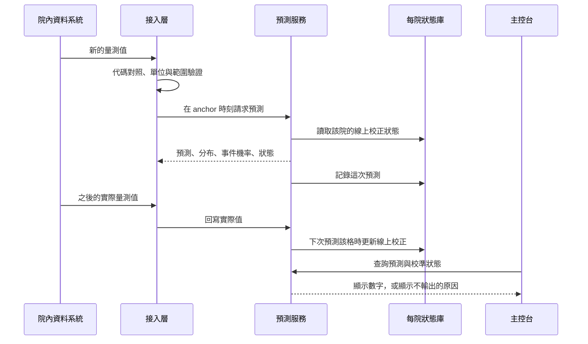
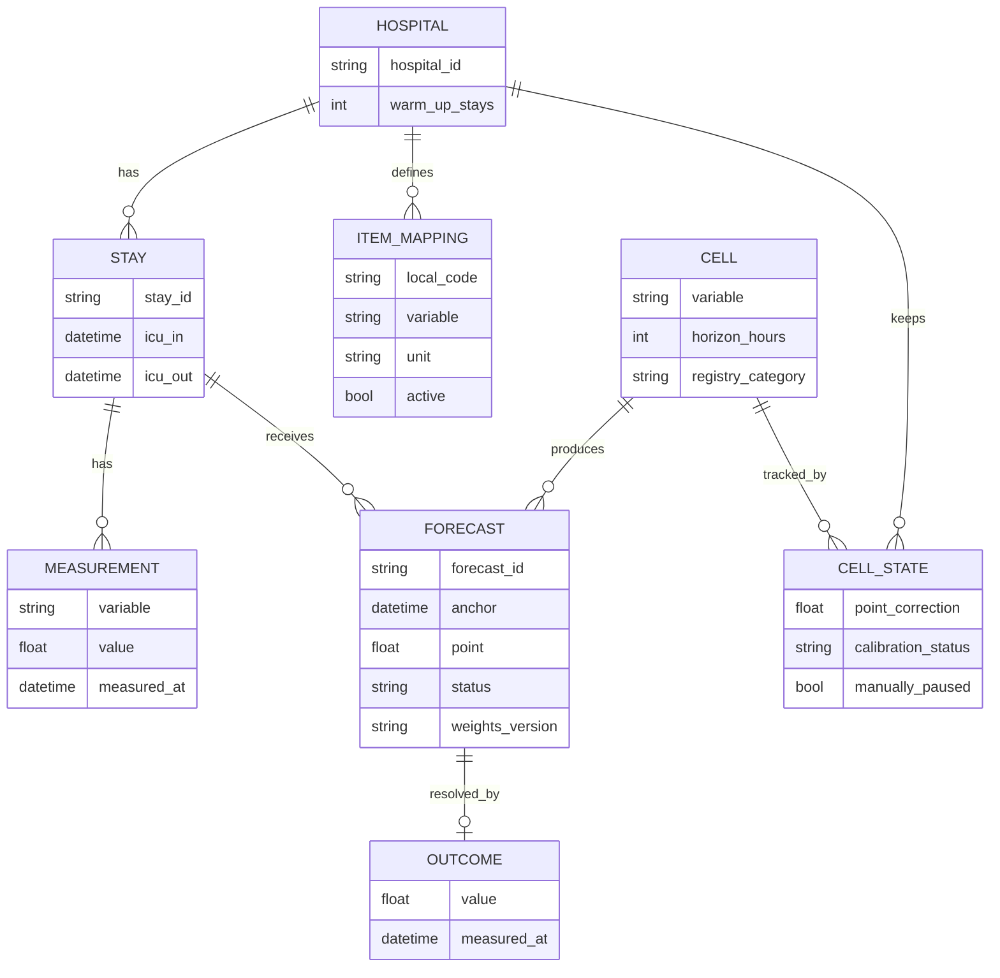

# Oslian 產品需求文件（PRD v1.0，2026-11-11）

> 配套文件：`OSLIAN_FEATURE_LIST_20261111.md`；原型：`oslian_prototype/coverage_matrix.html`
> 「Oslian」指 Osler ICU 預測模型的產品化版本：院內本機執行的預測服務，加上研究用主控台。
> 第 12 節列出我代你做的預設決定，任何一項你都可以改。

## 1. 一句話說明

Oslian 是在醫院內部機器上執行的 ICU 預測服務。它預測病人未來 1 到 48 小時的生命徵象和檢驗值，附上不確定性，並在每家醫院上線後用該院自己的資料持續校正。第一版是研究工具，不是臨床器材。

## 2. 背景與問題

- **多數 ICU 預測模型換一家醫院就退化。** 研究團隊很難判斷一個外來模型在自己醫院準不準。
- **已有的證據分兩級：**
  - Expert 預測：45 個「變數 × 時間窗」在多個外部資料庫上獨立重現。
  - M 預測（線上校正的分布與事件機率）：只在一個外部資料庫上評分過，屬於候選。
  - 細節以 `adaptive_replication_registry_20261102.json` 為準。
- **缺的是產品形態。** 目前只有本機 API（`osler_api/`），沒有院方對照工具、監看畫面和稽核介面。

## 3. 目標與非目標

**第一版目標**
1. 院內研究團隊可以把自己的資料接上，並看到預測。
2. 使用者隨時看得到每個預測的證據等級，以及它在本院是否校準。
3. 每個輸出都能追溯到輸入、權重版本和當時的狀態。

**非目標**
- 臨床決策建議、劑量建議、治療情境模擬。
- ICU 以外的病人。
- 對外公開的雲端服務。
- 3D 人體視圖。

## 4. 使用者

| 角色 | 想做的事 | 第一版提供 |
|---|---|---|
| 院內研究人員（主要） | 在本院資料上評估模型 | 覆蓋矩陣、病人預測頁、校準監看、警示負擔 |
| 資訊工程師 | 把院內資料接到服務 | 輸入契約、項目對照表、輸入驗證、健康檢查 |
| 研究主管或倫理審查 | 確認用途和資料邊界 | 使用聲明、版本與稽核紀錄 |
| 臨床醫師 | 不是第一版的目標使用者 | 只能以研究身分檢視 |

## 5. 產品組成

| 組件 | 內容 | 現況 |
|---|---|---|
| 預測服務 | FastAPI；Expert 與 M 兩組端點 | 已有 |
| 每院狀態庫 | SQLite；待回寫的預測、實際值、線上校正狀態 | 已有 |
| 接入層 | 項目對照、輸入驗證、anchor 組裝 | 未做 |
| 主控台 | 由預測服務直接提供的本機網頁，純 HTML 與 JavaScript | 覆蓋矩陣有原型 |

### 5.1 兩種預測

| | Expert | M |
|---|---|---|
| 變數 | 16 個變數中登錄表列為已重現的 45 格 | 6 個變數：MAP、心率、鉀、碳酸氫根、血糖、肌酸酐 |
| anchor 間隔 | 6 小時 | 3 小時 |
| 輸出 | 點預測；區間為空 | 點預測、15 個分位數、事件機率；可選聯合成員 |
| 狀態 | 無 | 每院一份，靠回寫的實際值更新 |
| 證據等級 | 已獨立重現 | 候選（單一外部資料庫） |

### 5.2 整體流程

### 5.3 資料結構

`stay_id` 一律是院方產生的假名，服務不接收姓名、病歷號等識別資料。

## 6. 預測服務需求（已有，第一版沿用）

### 6.1 端點

| 端點 | 用途 |
|---|---|
| `GET /health` | 服務、權重版本、契約版本 |
| `GET /v1/expert/cells` | 45 個 Expert 格子與各自的旗標 |
| `POST /v1/expert/forecast` | Expert 點預測 |
| `GET /v1/m/cells` | M 的格子、每格狀態、可接受的輸入欄位 |
| `POST /v1/m/forecast` | M 預測；可加 `joint: true` |
| `POST /v1/m/outcomes` | 回寫實際值 |

### 6.2 輸入規則

- 一個住院的 anchor 從第一個起依時間順序送，間隔固定。每個 anchor 只預測一次。
- 每個變數送最新值和「距量測幾小時」。缺值保持缺值，不得填 0。
- 前一個 anchor 的值、斜率、觀測旗標由服務重算。呼叫端送來的同名欄位會被丟棄，並列在回應裡。

### 6.3 輸出狀態

| `status` | 意思 | 輸出 |
|---|---|---|
| `ok` | 正常 | 數字 |
| `warm_up` | 該院還在前 200 個住院內 | 空值；資料仍用來累積狀態 |
| `outside_cohort` | 觀測到的器官模組少於 2 個 | 空值 |
| `current_value_missing` | 該變數沒有現值 | 空值 |
| `not_in_registry` | 這一格不在登錄表裡 | 空值 |

規則：不輸出時一律給空值和原因，不用任何未驗證的數字代替。

### 6.4 事件機率

- 事件機率是 50 個成員中落在事件範圍內的比例。
- 只有登錄表列為候選的事件會輸出：
  - MAP < 65：6 個時間窗；
  - 血糖 > 180：6 個時間窗；
  - 肌酸酐上升 ≥ 0.3：1 到 24 小時。
- 以下事件一律回空值和狀態：心率 > 120、鉀 ≥ 6、碳酸氫根 < 18、肌酸酐上升的 48 小時。
- 不輸出聯合事件機率。

### 6.5 結果回寫

- 實際值的量測時間要晚於 anchor，且落在目標時刻的容許範圍內：MAP 和心率 0.25 小時、血糖 1 小時、鉀和碳酸氫根 2 小時、肌酸酐 4 小時。
- 每格只收一個實際值。有多筆符合時，送最接近目標時刻的那筆。
- 實際值在該格下一次預測時才更新該院狀態，順序依預測發出的先後。
- 7 天內沒有回寫的預測會連同待處理狀態一起清掉。

## 7. 接入層需求（未做）

### 7.1 項目對照表頁

- **列表欄位：** 院方代碼、院方名稱、對到的變數、單位、是否啟用、最近 30 天筆數。
- **操作：** 新增、修改、停用；匯入、匯出 CSV。
- **規則：**
  - 一個院方代碼只能對到一個變數；一個變數可以有多個代碼。
  - 單位不在契約允許清單內時不能儲存，並提示允許的單位。
  - 修改對照只影響之後的預測。
  - 停用後該代碼的新量測值會被忽略，歷史紀錄保留。
- **空資料：** 顯示「尚未設定對照」，並列出待對照的 16 個變數。
- **篩選：** 變數、是否啟用；多個條件取交集。

### 7.2 輸入驗證

| 原因碼 | 情況 | 處理 |
|---|---|---|
| `unit_not_allowed` | 單位不在允許清單 | 拒絕該筆 |
| `out_of_range` | 數值超出合理範圍 | 拒絕該筆 |
| `after_anchor` | 量測時間晚於 anchor | 拒絕該筆 |
| `time_goes_back` | 同一住院的 anchor 時間倒退 | 拒絕整個請求 |
| `unmapped_code` | 院方代碼沒有對照 | 忽略該筆並計數 |

合理範圍和 extractor 使用的相同，不另訂一套。

### 7.3 對照檢查報告

- 每個變數顯示：筆數、缺漏率、時間精度（到分鐘、到小時、只有日期）、各原因碼的拒絕比例。
- 時間只有日期的變數標成「不能用於小時級預測」。
- 計數少於 10 時顯示「<10」。

### 7.4 歷史回放

- 用院方歷史資料依時間順序送入服務，產生暖機後的狀態。
- 回放期間的預測不顯示在病人預測頁，只用來累積狀態和計算校準。

## 8. 主控台需求

所有頁面頁首固定顯示「研究用，非臨床器材」，頁尾顯示登錄表版本和權重版本。

### 8.1 覆蓋矩陣頁（首頁；原型已做）

- **矩陣：** 16 個變數 × 6 個時間窗（1、3、6、12、24、48 小時），按生命徵象與尿量、生化、血液學分組。
- **兩個顯示層：**
  - 外部驗證類別：已獨立重現、候選、未通過、未納入。
  - 本院狀態：暖機中、校準中、在容許範圍內、偏離、不輸出。
- **互動：**
  - 點類別標籤篩選，其他格子變淡；再點一次取消。
  - 點格子，右側面板顯示該格的兩種類別、器官系統、服務會輸出什麼。
  - 切換醫院。
- **規則：** 只顯示類別，不顯示效能數字。未通過外部驗證的格子在本院狀態層一律顯示「不輸出」。
- **事件：** 矩陣下方另列一張事件表（事件 × 時間窗），用同樣的類別顯示。

### 8.2 病人預測頁

- **輸入：** 住院假名。查不到時顯示「找不到這個住院」。
- **內容：** 該住院最近一個 anchor 的預測。每個變數一張圖：過去的量測值、點預測、分位數帶。
- **證據等級：** 每張圖標示來源是 Expert（已獨立重現）還是 M（候選）。
- **事件機率：** 只顯示 6.4 節列出的事件。其他事件顯示「不提供機率」。
- **狀態：** `status` 不是 `ok` 的格子顯示原因文字，不顯示數字和顏色。
- **不提供：** 任何門檻建議、處置建議、風險排序名單。

### 8.3 校準監看頁

- **每格顯示：** 觀察值與預期值的比（O/E）、樣本數、病人數、狀態。
- **狀態判定：**
  - 樣本不足：少於 100 列或少於 30 位病人。只顯示「樣本不足」。
  - 在容許範圍內：O/E 在 0.8 到 1.25 之間。
  - 偏離：O/E 在範圍外。
- **偏離的處理：** 第一版只標記，不自動停止輸出。管理者可以手動暫停某一格；暫停後該格回空值並附原因。
- **篩選：** 變數、時間窗、時間區間；多個條件取交集。
- **空資料：** 暖機中的醫院顯示暖機進度，不顯示任何比例。

### 8.4 警示負擔頁（描述性；等 v14 定案後做）

- 選事件和機率門檻，顯示：每病人日警示數、警示段數、敏感度、漏報率、PPV。
- 「全部時間點」和「現值還沒越線的時間點」分開顯示。
- 計數少於 10 的格子不顯示比例。
- 只做描述，不建議任何門檻。

### 8.5 稽核頁

- 依住院假名、時間、格子查詢預測紀錄。
- 每筆顯示：輸入摘要、輸出、狀態、權重版本、契約版本、是否已回寫實際值。
- 只讀，不能修改或刪除。

## 9. 非功能需求

| 項目 | 需求 | 現況 |
|---|---|---|
| 部署 | 院內單機，不需要外部網路 | 已符合 |
| 資料邊界 | 病人資料不離開院內機器；無遙測回傳 | 已符合 |
| 存取 | 第一版只綁定本機 | 已符合 |
| 效能 | 單次 M 預測不超過 2 秒；每 3 小時一批，不要求即時 | 已符合（約 2 秒） |
| 可重現 | 相同輸入、狀態、權重版本得到相同輸出 | 已在真實資料上逐筆核對 |
| 完整性 | 權重、登錄表、凍結設定或 scikit-learn 版本與清單不符時拒絕啟動 | 已符合 |
| 稽核 | 預測紀錄不自動刪除，由管理者手動清理 | 未做（目前 7 天後清掉未回寫的預測） |

## 10. 成功指標

- **接入時間：** 一家新醫院從拿到安裝包到看到第一個預測的工作天數。
- **對照完整度：** 16 個變數中完成對照且時間精度到分鐘的比例。
- **本院校準：** 暖機結束後，已重現的格子中在容許範圍內的比例。
- **不輸出的透明度：** 空值回應都帶原因碼的比例，目標 100%。

這些是產品指標。模型效能的結論只來自凍結 protocol 下的外部評分。

## 11. 已知限制

- **研究用。** `clinical_promotion_allowed: false`，不能用於照護決策。
- **不做因果宣稱。** `causal_claim_allowed: false`，沒有治療情境模擬。
- **M 是候選。** M 的分布和事件機率只在一個外部資料庫上評分過。
- **三個事件沒有校準過的機率：** 鉀 ≥ 6、碳酸氫根 < 18、心率 > 120。
- **每院需要暖機。** 前 200 個住院沒有 M 的輸出。
- **外部驗證的範圍。** 已評分的外部資料庫是歐洲和韓國的 ICU；其他地區和 ICU 以外沒有證據。
- **床邊血糖** 在所有時間窗都未通過。
- **警示負擔的指標還沒定案。** v14 尚未凍結，下一個外部資料庫還沒選定。

## 12. 我代你做的預設決定

| 項目 | 預設 | 理由 |
|---|---|---|
| 產品範圍 | 預測服務加研究用主控台 | 和現有程式一致 |
| 第一個使用者 | 自己的研究團隊 | 不用先解決授權和認證 |
| 主控台技術 | 由預測服務提供的純 HTML 與 JavaScript 頁面 | 最簡單，不新增框架依賴 |
| 3D 人體視圖 | 不進第一版 | 只是呈現方式，不增加證據 |
| 變數數量 | 16 個（含床邊血糖） | 以登錄表為準 |
| 格子詳情 | 右側面板，不另開頁 | 原型已採用 |
| 偏離時的處理 | 只標記，手動暫停 | 沒有驗證過的自動停止規則 |
| 效能目標 | 單次 2 秒以內 | 預測每 3 小時一批 |
| 稽核保留 | 不自動刪除 | 院方規定各不相同 |

## 13. 風險

| 風險 | 影響 | 對策 |
|---|---|---|
| 訓練資料授權不允許對外提供模型 | 不能交付給其他醫院 | 交付前由你或法務確認各資料庫條款 |
| 被當成臨床警示系統使用 | 病人安全和法規問題 | 每頁標示、不提供門檻建議、不整合到照護流程 |
| 院方資料時間精度不足 | 小時級預測做不了 | 對照檢查報告在接入階段就擋下 |
| 院方對照錯誤 | 預測偏差 | 輸入驗證加上校準監看 |
| 把候選等級的輸出當成已驗證 | 過度信任 | 每個數字旁邊標示證據等級 |

## 14. 里程碑

1. **M1 接入：** 對照表、輸入驗證、檢查報告、歷史回放。
2. **M2 檢視：** 覆蓋矩陣頁（接上真實登錄表和狀態）、病人預測頁。
3. **M3 監看：** 校準監看頁、手動暫停、稽核頁。
4. **M4 警示負擔頁：** 等 v14 定案。

每個里程碑的驗收：功能清單中對應的 P0 項目全部完成並有測試；專案規定的四個模型測試照常通過。
